Voy a desarrollar la propuesta de la pollería como documento: datos de la empresa, problemática, modelo de datos en Mermaid y fuentes para el ETL. Primero verifico las fuentes abiertas reales que vamos a citar.

Aquí está la pollería desarrollada con la empresa, la problemática, el modelo de datos y de dónde sale cada dato para el ETL.

---

## 1. Ficha de la empresa

| Campo | Dato |
|---|---|
| Razón social | **INVERSIONES TITO BRASAS S.A.C.** |
| Nombre comercial | **Pollería Don Tito** |
| RUC | **20614837251** |
| Tipo de contribuyente | Sociedad Anónima Cerrada, Régimen MYPE Tributario |
| Actividad (CIIU Rev. 4) | 5610: actividades de restaurantes y de servicio móvil de comidas |
| Inicio de actividades | 15/03/2019 |
| Domicilio fiscal | Av. Próceres de la Independencia, San Juan de Lurigancho, Lima (dirección referencial) |
| Locales | Local 1: Zárate. Local 2: Canto Grande |
| Trabajadores | 22 (cocina, salón, caja, 4 motorizados propios, administración) |
| Ventas anuales | S/ 2.4 millones |
| Tamaño | Pequeña empresa |
| Canales | Salón, para llevar, delivery propio por WhatsApp, Rappi y PedidosYa |

**Sobre el tamaño:** la UIT 2026 vale S/ 5,500. Entonces S/ 2.4 millones equivalen a unas 436 UIT. Según la Ley 30056, eso corresponde a pequeña empresa (entre 150 y 1,700 UIT).

**Sobre el RUC:** es ficticio. Lo generé con el formato y el dígito verificador correctos de SUNAT, pero no pude consultarlo desde aquí. Antes de presentar, busquen "20614837251" en la Consulta RUC de SUNAT para confirmar que no pertenece a una empresa real. Declaren en el informe que la empresa y sus datos son simulados, porque eso cumple con la regla del curso sobre datos sin autorización. Si consiguen una pollería real que les autorice, usen su RUC verdadero.

**Misión:** Servir el mejor pollo a la brasa de San Juan de Lurigancho, con sabor casero, atención rápida y precios justos para las familias del distrito, en el local o en su casa.

**Visión:** Al 2029, ser la pollería de referencia de Lima Este, con 4 locales y una operación rentable guiada por datos.

---

## 2. Problemática central

> **"Vendemos más, pero ganamos menos."** En el último año las ventas de Don Tito crecieron 18%, pero su margen neto cayó de 14% a 8%.

Hay tres causas que se pueden medir:

1. **Canales sin control de rentabilidad.** Las apps pasaron de 15% a 35% de las ventas y cobran entre 25% y 30% de comisión. Los precios son iguales en todos los canales y nadie sabe cuánto deja realmente cada uno.
2. **Producción "a ojo".** El jefe de cocina decide cuántos pollos poner al horno por turno según su experiencia. La merma es de 7% de los pollos preparados, cuando lo sano es 3% o menos. Los domingos falta pollo y los martes sobra.
3. **Insumo volátil y no monitoreado.** Ejemplo real de MIDAGRI: en Lima Metropolitana, el pollo vivo pasó de S/ 6.10 por kilogramo el 1 de julio a S/ 6.90 al 14 del mismo mes. Don Tito no relaciona estas subidas con su margen ni ajusta sus precios.

**Causas para el Ishikawa (6M):**
- **Método:** precios iguales en todos los canales y producción sin pronóstico.
- **Mano de obra:** la cajera registra los pedidos de WhatsApp a mano.
- **Materiales:** precio del pollo volátil.
- **Medición:** tres sistemas que no se cruzan (caja, apps y WhatsApp).
- **Máquina:** el sistema de caja no se integra con las apps.
- **Medio:** competencia de cadenas grandes y de otras pollerías del distrito.

**Objetivo general:** Implementar una solución de Inteligencia de Negocios en Power BI que integre las ventas de todos los canales, la producción por turno y el precio del pollo, para recuperar un margen neto de 12% en 6 meses.

**Objetivos específicos:**
1. Integrar y depurar las fuentes de ventas (caja, Rappi, PedidosYa y WhatsApp) mediante un proceso ETL en Power Query.
2. Medir el margen de contribución por canal y por producto.
3. Pronosticar la demanda de pollos por día y turno para bajar la merma de 7% a 3%.
4. Monitorear el efecto del precio del pollo vivo en el costo y el margen.
5. Construir un dashboard con KPIs, metas y filtros que guíe las decisiones de precio, producción y personal.

---

## 3. Modelo de datos

Es una constelación con tres tablas de hechos que comparten dimensiones. La tabla principal, *fPedidos*, guarda una fila por cada línea de cada pedido.

```mermaid
erDiagram
    dCalendario ||--o{ fPedidos : "fecha_key"
    dHora ||--o{ fPedidos : "hora_key"
    dTurno ||--o{ fPedidos : "turno_key"
    dLocal ||--o{ fPedidos : "local_key"
    dCanal ||--o{ fPedidos : "canal_key"
    dProducto ||--o{ fPedidos : "producto_key"
    dCliente ||--o{ fPedidos : "cliente_key"
    dZona ||--o{ fPedidos : "zona_key"
    dCalendario ||--o{ fProduccionTurno : "fecha_key"
    dLocal ||--o{ fProduccionTurno : "local_key"
    dTurno ||--o{ fProduccionTurno : "turno_key"
    dCalendario ||--o{ fPrecioPollo : "fecha_key"

    fPedidos {
        string pedido_id "ID de origen"
        int linea
        string fuente "POS, RAPPI, PEDIDOSYA, WHATSAPP"
        int fecha_key FK
        int hora_key FK
        int turno_key FK
        int local_key FK
        int canal_key FK
        int producto_key FK
        int cliente_key FK
        int zona_key FK
        int cantidad
        decimal precio_unitario
        decimal descuento
        decimal venta_bruta
        decimal comision
        decimal costo_estimado
        decimal pollos_equivalentes "cantidad x fraccion_pollo"
        int tiempo_entrega_min
        bool cancelado
    }

    fProduccionTurno {
        int fecha_key FK
        int local_key FK
        int turno_key FK
        int pollos_preparados
        int pollos_vendidos
        int pollos_sobrantes
        decimal costo_merma
    }

    fPrecioPollo {
        int fecha_key FK
        decimal precio_vivo_distribucion_kg
        decimal precio_granja_kg
        decimal precio_eviscerado_minorista_kg
        decimal peso_promedio_kg
        bool valor_imputado "fin de semana sin boletin"
    }

    dCalendario {
        int fecha_key PK
        date fecha
        int anio
        int mes
        string nombre_mes
        int semana
        string dia_semana
        bool es_fin_de_semana
        bool es_feriado
        bool es_quincena
        string evento "Dia del Pollo a la Brasa, Madre, Fiestas Patrias"
    }

    dHora {
        int hora_key PK
        int hora
        string franja "Almuerzo, Lonche, Cena"
    }

    dTurno {
        int turno_key PK
        string turno "Manana, Tarde, Noche"
        string hora_inicio
        string hora_fin
    }

    dLocal {
        int local_key PK
        string nombre_local
        string zona_local
        int aforo
        date fecha_apertura
    }

    dCanal {
        int canal_key PK
        string canal "Salon, Para llevar, Delivery propio, Rappi, PedidosYa"
        string tipo "Directo o App"
        decimal comision_pct
    }

    dProducto {
        int producto_key PK
        string nombre_producto
        string categoria "Pollo, Combo, Parrilla, Bebida, Extra"
        decimal fraccion_pollo "1, 0.5, 0.25, 0"
        decimal precio_lista
        decimal costo_estandar
    }

    dCliente {
        int cliente_key PK
        string cliente_hash "telefono anonimizado"
        string tipo_cliente "Registrado o Anonimo"
        date fecha_primera_compra
    }

    dZona {
        int zona_key PK
        string distrito
        string sector "Zarate, Canto Grande, Bayovar, Mariscal Caceres"
        string zona_reparto
        int poblacion_ref "INEI"
    }
```

Decisiones de diseño que pueden sustentar en la exposición:
- **`fraccion_pollo` en dProducto:** convierte cualquier venta en "pollos equivalentes". Así un ¼ de pollo vale 0.25 y un pollo entero vale 1. Gracias a eso se pueden comparar las ventas con los pollos producidos.
- **dTurno es compartida:** *fPedidos* y *fProduccionTurno* usan la misma dimensión de turno. Así se cruza la demanda con la producción en un mismo visual. La cantidad de pollos sobrantes sale de la planilla de cocina, mientras que los pollos equivalentes vendidos salen de *fPedidos*.
- **Relaciones:** todas son de uno a muchos y en una sola dirección. dCalendario se marca como tabla de fechas.

---

## 4. Fuentes de datos y flujo ETL

```mermaid
flowchart LR
    subgraph FI["Fuentes internas (simuladas)"]
        A1["POS salon L1 y L2<br/>CSV diario"]
        A2["Rappi y PedidosYa<br/>Excel del portal de socios"]
        A3["Pedidos WhatsApp<br/>Google Sheets de caja"]
        A4["Planilla de produccion<br/>Excel de cocina"]
        A5["Maestro de productos y costos<br/>Excel"]
    end
    subgraph FE["Fuentes abiertas reales"]
        B1["MIDAGRI<br/>boletin diario de aves PDF"]
        B2["gob.pe<br/>feriados nacionales"]
        B3["INEI<br/>poblacion por distrito"]
    end
    subgraph ST["Staging: carpeta OneDrive o SharePoint"]
        C1["01_raw por fuente y mes"]
    end
    subgraph PQ["ETL en Power Query"]
        D1["Limpieza, tipos y formatos"]
        D2["Homologacion de productos, canales y zonas"]
        D3["Anexar fuentes en fPedidos"]
        D4["Anonimizar clientes"]
    end
    subgraph PBI["Power BI"]
        E1["Modelo constelacion + DAX"]
        E2["Dashboard + pronostico"]
        E3["Power BI Service<br/>actualizacion programada"]
    end
    FI --> C1
    FE --> C1
    C1 --> D1 --> D2 --> D3 --> D4 --> E1 --> E2 --> E3
```

### Fuentes internas (las simulan ustedes)

| Fuente | Formato | Tabla destino | Problemas que deben tener (para lucir el ETL) |
|---|---|---|---|
| Sistema de caja del salón (2 locales) | CSV diario | fPedidos | Fechas dd/mm/aaaa, filas duplicadas cuando se reimprime un ticket |
| Reportes de Rappi y PedidosYa | Excel exportado | fPedidos | Fechas en otro formato y con zona horaria, nombres de platos distintos ("1/4 Pollo + papas" frente a "Cuarto de pollo c/ papas"), columna de comisión |
| Pedidos de WhatsApp | Google Sheets llenado por la cajera | fPedidos, dCliente, dZona | Sectores mal escritos ("Zarate", "ZÁRATE", "zárate"), teléfonos con y sin +51, tiempos de entrega vacíos |
| Planilla de producción | Excel por turno | fProduccionTurno | Celdas vacías y turnos escritos de distintas formas |
| Maestro de productos y costos | Excel | dProducto, dCanal | Productos con precios desactualizados |

**Volumen recomendado para la simulación:** 12 meses, de noviembre de 2025 a octubre de 2026. Con unos 120 pedidos diarios entre los dos locales y 2.2 líneas por pedido, salen alrededor de 95 mil filas en *fPedidos*. Genérenlo con un script de Python (pandas y numpy) que incluya estacionalidad realista:
- Fines de semana con 40% más de pedidos y el domingo como día más fuerte.
- Picos en la cena, entre las 19:00 y las 21:00.
- Más ventas en quincena y fin de mes.
- Fechas especiales: Día del Pollo a la Brasa (tercer domingo de julio), Día de la Madre, Fiestas Patrias y Navidad.
- La participación de las apps creciendo mes a mes, que es justamente la historia que van a contar.
- Entre 2% y 3% de errores introducidos a propósito para que el ETL tenga algo que limpiar.

### Fuentes abiertas reales (dan credibilidad y sirven para el PESTEL)

- **MIDAGRI, boletín de abastecimiento y precios de aves:** se publica a diario en PDF en gob.pe. Para Lima trae el precio en granja (pollo vivo), centros de distribución (pollo vivo), mercados minoristas (pollo eviscerado) y el peso promedio por pollo (kg x unid.). El ETL se luce aquí: Power Query lee los PDF con "Obtener datos desde carpeta", extrae la tabla y rellena los días sin boletín (fines de semana o feriados) con el último valor publicado. Esos días quedan marcados en el campo `valor_imputado`.
- **gob.pe, feriados nacionales:** para el campo `es_feriado` de dCalendario.
- **INEI, población por distrito:** para dZona. Les sirve para calcular la penetración por sector.
- **SENAMHI (opcional):** tiene un portal de descarga de datos hidrometeorológicos. Pueden usar la temperatura para probar si el frío del invierno limeño sube la demanda.
- **BCRP, inflación de Lima:** para el PESTEL (factor económico).

### Pasos del ETL que deben documentar con capturas de "antes y después"

1. Importar y combinar los archivos por carpeta (caja, apps y boletines de MIDAGRI).
2. Asignar tipos de dato con la configuración regional es-PE y convertir las horas de las apps a hora de Lima.
3. Aplicar limpieza de texto: Recortar, Limpiar y mayúsculas consistentes. Normalizar los sectores con una tabla de equivalencias.
4. Combinar con una **tabla de homologación de productos**, de modo que todos los nombres de las apps apunten a un solo `producto_key`.
5. Quitar duplicados por la combinación de `fuente`, `pedido_id` y `linea`. Reporten cuántas filas se eliminaron.
6. Tratar los nulos. Por ejemplo, el tiempo de entrega en salón queda como "no aplica".
7. Calcular columnas: comisión según el canal, costo estimado, pollos equivalentes y turno según la hora.
8. Anexar las cuatro fuentes en una sola tabla *fPedidos*.
9. Anonimizar a los clientes: cambiar el teléfono por un código y no cargar direcciones exactas, solo el sector. Esto cumple con la Ley 29733.

**Herramientas:** Excel y Google Sheets (fuentes), Python (simulación), Power Query (ETL), DAX (medidas), Power BI Desktop (modelo y dashboard) y Power BI Service (publicación y actualización programada). El almacenamiento puede ser una carpeta en OneDrive o SharePoint, que es suficiente y barato para una pyme. Si quieren sumar puntos en arquitectura, propongan SQL Server Express como mini almacén de datos en una fase 2.

---

## 5. KPIs con meta

| KPI | Fórmula | Valor actual | Meta |
|---|---|---|---|
| Margen neto global | Utilidad neta / Ventas | 8% | 12% |
| Margen de contribución por canal | (Venta − Comisión − Costo) / Venta | Apps alrededor de 37%, salón alrededor de 65% | Apps de 40% o más, con precio diferenciado |
| % de merma | Pollos sobrantes / Pollos preparados | 7% | 3% o menos |
| Precisión del pronóstico (MAPE) | Promedio de \|real − pronóstico\| / real | — | 15% o menos |
| Participación del canal directo | Ventas de salón, para llevar y delivery propio / Ventas totales | 65% | 70% o más |
| Tiempo de entrega del delivery propio | Promedio de `tiempo_entrega_min` | 42 min | 35 min o menos |
| % de pedidos cancelados | Pedidos cancelados / Pedidos totales | 5% | 3% o menos |

---

## 6. Dashboard propuesto (6 páginas)

1. **Resumen ejecutivo:** tarjetas de KPI con semáforo frente a la meta y la tendencia del margen.
2. **Rentabilidad por canal:** cascada que va de la venta bruta a la comisión, al costo y al margen, con el detalle por producto.
3. **Demanda:** mapa de calor de día de la semana por hora y el **pronóstico** de pollos por día y turno con la función nativa de Power BI.
4. **Producción y merma:** pollos preparados frente a vendidos por turno, y el costo de la merma.
5. **Costo del insumo:** precio del pollo vivo según MIDAGRI frente al margen diario.
6. **Delivery y zonas:** pedidos y tiempos de entrega por sector de San Juan de Lurigancho.

**Filtros en todas las páginas:** fecha, local, canal, turno y categoría de producto.

**Recomendaciones que debería poder sostener el storytelling:**
- Subir entre 10% y 12% los precios en las apps.
- Preparar los pollos de cada turno según el pronóstico.
- Promocionar el delivery propio por WhatsApp con un descuento menor que la comisión de las apps.

---

Cuando lo aprueben, puedo seguir con el script de Python que genera los datos simulados (con la suciedad incluida para el ETL) o con el diagnóstico completo: Canvas, PESTEL, FODA e Ishikawa armado.